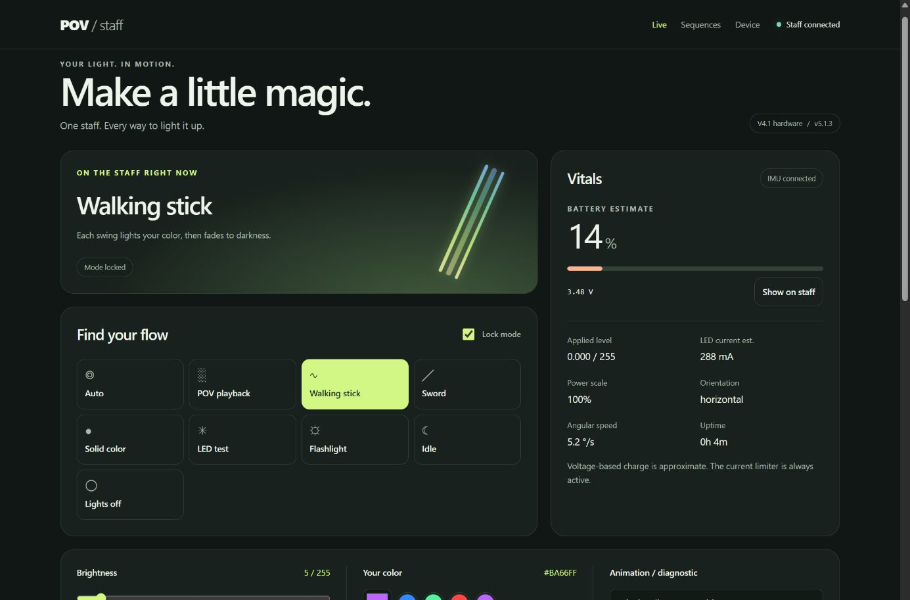
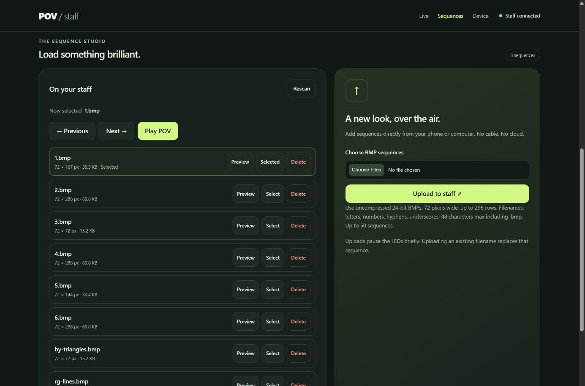
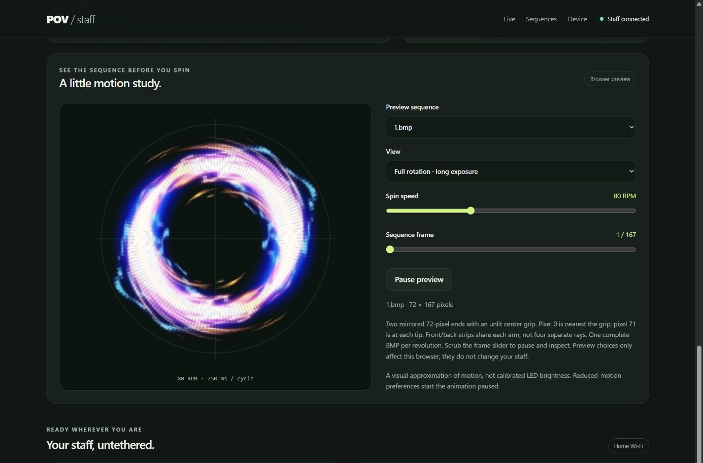

# POV Staff

Wireless control for the **Island Robotics V4.1 staff**, running on an **Adafruit QT Py ESP32-S3 with 8 MB flash**. Upload light sequences, preview them in your browser, choose motion effects, and install firmware updates over Wi-Fi.

**Firmware 5.2.0** starts at brightness **5 / 255**. The staff has two illuminated ends, each with 72 pixels on front and back strips, and an unlit center grip.

## Connect

1. Power on the staff and join its open **POVSTAFFxxxx** Wi-Fi network. The suffix identifies your board. If your phone warns that this network has no Internet, stay connected.
2. Open [192.168.4.1](http://192.168.4.1/) or [povstaff.local](http://povstaff.local/). No dashboard login is required.
3. Choose a mode in **Live**, or open **Sequences** to upload BMPs.

For home Wi-Fi, open **Device → Wi-Fi & connection**, choose **Home Wi-Fi · client**, enter your network details, and save. **Power cycle to apply the change.** Saving does not interrupt your current session. On your home network, use `povstaff.local` or the address assigned by your router.

If the configured network cannot be reached within ten seconds, or the connection is lost, the staff opens its own network. It stays in that fallback mode until the next boot. Select **Open staff hotspot · default** and save if you want it to start as a hotspot again.

The hotspot and Arduino OTA have no password. Anyone connected to the staff's network can control it or install firmware. Home Wi-Fi credentials are stored on the device and are never returned by the dashboard.

## Upload and play sequences

In **Sequences**, choose one or more BMP files and click **Upload to staff**. Files are stored in LittleFS; no filesystem image or separate file-transfer program is needed. Uploading the same filename replaces that sequence. Uploads briefly pause the main LEDs.

| Requirement | Value |
| --- | --- |
| Image format | Uncompressed 24-bit BMP |
| Width | Exactly 72 pixels |
| Height | 1–296 rows |
| Filename | Letters, numbers, hyphens and underscores; up to 44 characters before `.bmp` |
| Library | Up to 50 sequences, subject to available space |

The files in [images/](images/) include two ready-to-upload BMP examples. Each image row becomes one LED frame, played from the visual top of the image to the bottom.

Click **Select** beside a file, then **Play POV**, and spin the staff. **Seconds per sequence** controls how long each image plays before advancing through the library in filename order. Set it to **0** to hold the selected image. Names such as `01-stars.bmp` and `02-rings.bmp` set a predictable order. **Rescan** refreshes the library; **Delete** removes a sequence.

Files survive power cycles and application firmware updates. If storage is unavailable, the dashboard offers explicit initialization under **Maintenance & storage recovery**; it never automatically erases your files.

## Preview before you spin

Click **Preview** beside any file. Choose **Spinning** for a short light trail, **Stationary** for animated LEDs without rotation, or **Full rotation** for a long-exposure view. Speed defaults to **80 RPM**, equivalent to one BMP cycle every **750 ms**, and can be adjusted from 20 to 200 RPM. Pause or scrub through individual frames.

Previewing a file does not change the staff's selected sequence or mode. The browser caches up to 12 decoded BMPs and renders them locally, without adding preview files to staff storage.

The visualization models two identical 50 cm LED arms around a 41 cm dark grip, with pixel 0 nearest the grip and pixel 71 at each tip. It assumes one complete BMP per revolution. Physical brightness and perceived persistence will differ from the screen.

## Lighting modes

| Dashboard mode | What it does |
| --- | --- |
| **Auto** | Motion selects POV. When still, horizontal selects LED Test, upright selects Walking Stick, and other orientations settle into Idle. |
| **POV playback** | Plays BMP frames in time with measured rotation. Stops showing frames when the staff is still. |
| **Walking stick** | Each swing lights your selected color, then fades to black over about 0.8 seconds. |
| **Sword** | Keeps your chosen color illuminated, with shimmer and brighter accents during fast movement. |
| **Solid color** | Steady light in your chosen color. |
| **LED test** | Runs the selected diagnostic or animation: rainbow, pixel walk, RGB channel fades, gradient, breathing, or chase. |
| **Flashlight** | Warm white light with a separate brightness cap. |
| **Idle / Lights off** | Both leave the main strips dark while Wi-Fi and the onboard heartbeat remain active. Idle is also Auto's resting state. |

Selecting a mode locks it. Turn off **Lock mode** to return to Auto. **Show on staff** briefly displays the estimated battery charge when operating from a battery.

For Walking Stick, briefly hold the staff still before the first swing. A swing above 45 degrees/second triggers a 40 ms rise followed by an 800 ms fade. Slowing below 18 degrees/second rearms the next pulse. Continuous rotation produces one pulse until you slow down; use POV for continuous spinning imagery. The color picker controls Walking Stick, Sword, Solid, Breathing, and Chase.

## Smooth rendering

All main-strip output uses the same staggered four-step dithering: procedural animations, walking and sword effects, solid colors, battery displays, and BMP playback. The onboard status heartbeat is separate. There is no renderer switch; dithering is active from startup.

Fractional channels are rounded to quarter-code levels, with pulses distributed across pixels. Values below 1/8 of one output code become black instead of rare flashes. Current limits apply to every packet, and Lights off remains completely black. Movement may still reveal grain.

Open **Rendering** to see actual output frequency and transfer timing. Output refresh targets 1,000 Hz, with the achieved rate depending on network activity. Animation scenes update at about 100 Hz; POV scenes follow measured rotation and image height. Higher output refresh does not increase animation or sensor sampling rates. **Run breathing test** selects LED Test / breathing and keeps the current brightness and color.

## Brightness and power

Every boot starts at **5 / 255 brightness** to reduce startup load. The brief startup battery display uses **3 / 255**. You can increase brightness during use; mode, color, brightness, and playlist timing reset at reboot. Wi-Fi configuration and uploaded sequences persist.

On battery, the configured brightness maximum is 64 / 255, Flashlight is capped at 20 / 255, and the estimated LED-current budget is 1,800 mA. A detected USB host limits brightness to 16 / 255 and estimated LED current to 500 mA. A supported USB supply is displayed as **USB POWER**, with supply voltage instead of a battery percentage.

Battery cutoff is 3.20 V, with recovery at 3.35 V. Low or unsupported voltage readings hold the main strips off. Voltage, charge percentage, and LED current are estimates; firmware limits do not establish the measured electrical capability of the assembled staff.

## Firmware updates and development

See [Build and flash](BUILD.md) for the pinned toolchain, first USB installation, browser updates, and Arduino OTA. Upload only the application **POV4.1.ino.bin** in **Device → Firmware update**. Keep the staff powered until it returns after reboot. Application updates preserve sequences and Wi-Fi settings.

See [API.md](API.md) for local automation endpoints and [code/README.md](code/README.md) for the source layout. The maintained sketch is [code/POV4.1/POV4.1.ino](code/POV4.1/POV4.1.ino).

| Directory | Contents |
| --- | --- |
| `code/POV4.1/` | Firmware, embedded dashboard, and preview renderer |
| `docs/` | Hardware assembly and operating guides, plus dashboard screenshots |
| `hardware/` | PCB designs and mechanical models |
| `images/` | Sample BMP sequences |
| `tests/`, `tools/` | Host checks and build helpers |

## Credits and license

Original project by Alexander Kirillov, based on work by Phillip Burgess and Erin St Blaine at Adafruit. Hardware assembly documentation remains in [docs/](docs/). This fork replaces the original firmware with the version 5 implementation. Licensed under [MIT](LICENSE).
